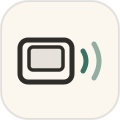
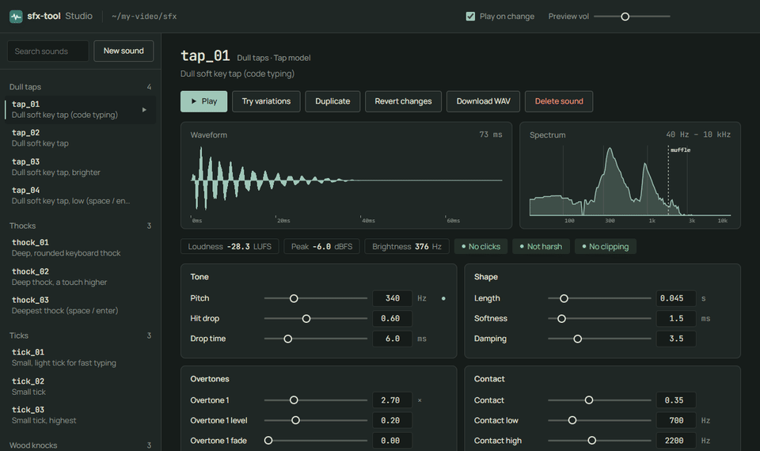

<p align="center">
  
</p>

<h1 align="center">sfx-tool</h1>

<p align="center">
  Um espaço de trabalho de efeitos sonoros para agentes de IA: seu agente cria os sons, você ouve e ajusta.<br>
  <sub>Peça um som com suas palavras, ouça no Studio um segundo depois e ajuste de ouvido até ficar certo. Tudo roda no seu computador.</sub>
</p>

<p align="center"><a href="https://github.com/OpenRootdev/sfx-tool#readme">English</a> · <a href="https://github.com/OpenRootdev/sfx-tool/blob/translations/README.es.md">Español</a> · <a href="https://github.com/OpenRootdev/sfx-tool/blob/translations/README.de.md">Deutsch</a> · <a href="https://github.com/OpenRootdev/sfx-tool/blob/translations/README.fr.md">Français</a> · <a href="https://github.com/OpenRootdev/sfx-tool/blob/translations/README.ja.md">日本語</a> · <a href="https://github.com/OpenRootdev/sfx-tool/blob/translations/README.zh-CN.md">简体中文</a> · <b>Português</b></p>

<p align="center">
  
</p>

<p align="center">
  <a href="https://github.com/OpenRootdev/sfx-tool/releases/latest/download/sfx-tool.zip"><b>Baixar</b></a> &nbsp;·&nbsp; <a href="#começar">Começar</a> &nbsp;·&nbsp; <a href="https://github.com/OpenRootdev/sfx-tool/blob/main/skill/SKILL.md">Skill para agentes</a>
</p>

<p align="center">
  <sub>Funciona com</sub><br>
  &nbsp;Claude Code &nbsp;·&nbsp; <picture><source media="(prefers-color-scheme: dark)" srcset="https://raw.githubusercontent.com/OpenRootdev/sfx-tool/assets/brands/openai-dark.svg"></picture>&nbsp;Codex &nbsp;·&nbsp; &nbsp;Node.js &nbsp;·&nbsp; &nbsp;FFmpeg
</p>

## O que faz

Seu agente escreve cada som como um pequeno arquivo de receita, e o Studio toca o som assim que o arquivo muda. Você ouve, move um controle ou escolhe uma de oito variações, e o agente também vê suas mudanças. Quando estiver bom, exporte um WAV ou uma trilha de digitação inteira para o seu vídeo.

- Descreva um som ("mais suave", "mais amadeirado", "como um teclado de verdade") e seu agente o cria; você nunca escreve código de áudio.
- Tudo é ao vivo: forma de onda, espectro e checagem de volume se atualizam quando você ou o agente editam.
- Feito no seu computador, sem conta, chave de API ou créditos. Vem com 34 sons de exemplo (teclas, batidas, bolhas, sininhos) para começar.

## Começar

1. Instale o <a href="https://nodejs.org">Node.js</a> 18 ou mais recente.
2. Copie a pasta <code>skill/</code> para a pasta de skills do seu agente (no Claude Code: <code>~/.claude/skills/sfx-tool</code>).
3. Abra um terminal na pasta do seu projeto e rode o comando abaixo. Ele cria uma pasta <code>sfx/</code> e abre o Studio no navegador.
4. Peça ao seu agente com suas palavras, por exemplo <i>"Faça um clique suave de madeira para cada letra digitada e um sininho leve quando a linha terminar."</i> Os sons novos aparecem no Studio, prontos para ajustar.

```bash
npx github:OpenRootdev/sfx-tool studio --open
```

## O que você precisa

- Node.js 18 ou mais recente. Nada mais para instalar.
- Um agente de IA que use skills e rode comandos, como Claude Code ou Codex. O Studio também funciona sozinho.
- Um navegador para o Studio.

## O que vem dentro

- [`skill/SKILL.md`](https://github.com/OpenRootdev/sfx-tool/blob/main/skill/SKILL.md) · Como seu agente transforma uma descrição em som e trabalha com você no Studio.
- [`studio/`](https://github.com/OpenRootdev/sfx-tool/blob/main/studio/) · A página onde você ouve e ajusta os sons.
- [`bin/sfx-tool.js`](https://github.com/OpenRootdev/sfx-tool/blob/main/bin/sfx-tool.js) · O comando que seu agente (ou você) roda: cria sons, variações e trilhas de digitação.
- [`src/`](https://github.com/OpenRootdev/sfx-tool/blob/main/src/) · Os modelos de som e os sons de exemplo.

<sub>As imagens de prévia ficam no branch <a href="https://github.com/OpenRootdev/sfx-tool/tree/assets"><code>assets</code></a> e as traduções em <a href="https://github.com/OpenRootdev/sfx-tool/tree/translations"><code>translations</code></a>, então o <code>main</code> tem só a ferramenta.</sub>

---

<sub>Licença MIT · <a href="https://github.com/OpenRootdev">OpenRootdev</a></sub>
